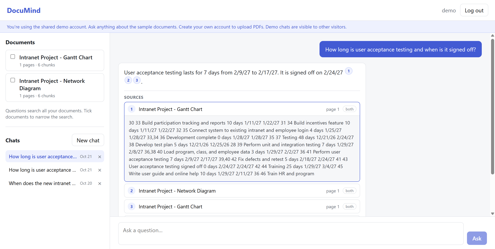
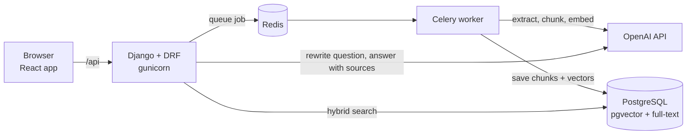

# DocuMind


AI document assistant that answers questions about your PDFs and cites the exact page each answer came from.

Live demo: https://documind-abrar.onrender.com — click "Try the demo account" (no sign-up needed).
Free hosting: the first load after a quiet period can take up to a minute.

<!-- Demo video: add the unlisted YouTube link here -->
<!--  -->

## What it does

- Upload a PDF and ask questions about it in plain English
- Every answer cites its sources, and clicking a citation opens the exact passage and page number
- If the answer isn't in your documents, it says so instead of guessing
- Follow-up questions work ("Does that apply to the final project too?")
- Chats are saved, and each user only ever sees their own documents and conversations
- Uploads are processed in the background with live status (Queued → Processing → Ready)

## Tech stack

| Layer | Tools |
|---|---|
| Backend | Python, Django, Django REST Framework, token authentication |
| AI | OpenAI embeddings (`text-embedding-3-small`) and chat (`gpt-4.1-mini`) |
| Search | PostgreSQL with pgvector (HNSW index) and PostgreSQL full-text search |
| Background jobs | Celery with Redis |
| Frontend | React (Vite) |
| Testing and CI | Django test runner, GitHub Actions |
| Deployment | Docker, Render (blueprint in `render.yaml`), Neon Postgres |

## Architecture



In production, Django serves both the API and the built React app from one Docker container, and the Celery worker runs alongside it. The database is hosted on Neon and Redis on Render.

## How it works

1. Ingestion (background job). The worker reads each PDF page with `pypdf`, splits pages into roughly 800-character chunks with 150 characters of overlap, and creates an embedding for each chunk. Chunks never cross page boundaries, so every chunk has exactly one page number to cite. Processing is idempotent: running the same job twice replaces the old chunks instead of duplicating them, which makes retries safe.
2. Query building. For follow-up questions, the model rewrites the question into a standalone one ("Does that apply…" becomes "Does the late work policy apply…"). Search then runs with both the original and the rewritten question, so a bad rewrite can't hide a good result.
3. Hybrid retrieval. Each question runs through vector search (meaning) and PostgreSQL full-text search (exact words like course codes, emails and room numbers). The two ranked lists are merged with Reciprocal Rank Fusion. Every query is filtered by owner, so a user's search can never touch someone else's documents.
4. Answering. The top 5 chunks go to the model with numbered sources and strict rules: use only the sources, cite every claim, and reply "I couldn't find that in your documents" when the answer isn't there.

## Evaluation

I built a labeled question set (`backend/evaluation/questions.json`) and a scoring command (`python manage.py evaluate`) to measure retrieval instead of guessing. The set has 31 questions over three documents: 20 answerable (semantic, exact-term and follow-up questions) and 11 unanswerable.

| Metric (hybrid search) | Baseline | After tuning |
|---|---|---|
| Hit@5 (correct page in the 5 chunks the model sees) | 85.0% | 95.0% |
| Hit@1 | 65.0% | 70.0% |
| MRR | 0.729 | 0.801 |
| Answers with a correct citation | — | 90% (18/20) |
| Unanswerable questions correctly refused | — | 100% (11/11) |

Held-out check: 10 new questions, written after tuning and run once, scored Hit@5 100%, correct citations 8/8 and refusals 2/2. It's a small sample, so I treat it as a sign the tuning didn't overfit rather than as a headline number.

What the experiments showed:

- Email-safe tokens were the biggest single fix. The keyword search split `jlewis@collin.edu` into "jlewis", "collin" and "edu", which matched dozens of unrelated chunks. Keeping emails, course codes and room numbers whole moved that question from not found to rank 1.
- Hybrid beats vector-only on exact terms. The course code `ITSE-1359` ranked 1st with hybrid and 3rd with vector search alone.
- Query strategy matters for follow-ups. Rewriting alone sometimes added irrelevant context (asking "How many credit hours is this course?" after a question about AI rules got rewritten to include the AI policy). Searching with both the original and the rewritten question fixed that. A query-expansion strategy was tested and rejected: it was slower, less stable between runs, and hurt refusals.
- Distance alone can't detect unanswerable questions. Correct answers had distances from 0.31 to 0.71, and the closest chunks for unanswerable questions fell between 0.47 and 0.69, so no cutoff separates them. The system prompt is the guard that refuses, and the evaluation confirms it works.

Full results for every run are saved in `backend/evaluation/results/`.

## Testing

52 automated tests run on every push with GitHub Actions, against a real PostgreSQL + pgvector database:

- API permissions: users can't view, delete or search other users' documents or chats (returns 404, not 403)
- Upload validation: real PDF header check, file size limit, per-user document limit
- Ingestion: chunk page numbers, idempotent re-runs, scanned PDFs marked as failed
- Search: email/code tokenization, relevance rule, owner and document filters, hybrid ranking
- Chat: conversation history, nothing saved when the AI service fails
- Demo account: read-only, shared token survives logout

OpenAI is never called in tests. A deterministic fake embedding function keeps search tests meaningful and free, and any accidental real API call fails the test.

## Security and abuse protection

- Every query is filtered by the logged-in user, and other users' records return 404 so their existence isn't revealed
- Uploaded files are never exposed through a public URL
- Rate limits on questions, uploads and sign-ups, plus a per-user document limit
- A shared demo account that can ask questions but not upload or delete
- Secrets live in environment variables, never in the repository

## Run it locally

Requirements: Python 3.12+, Node 22+, Docker Desktop, and an OpenAI API key.

```bash
git clone https://github.com/zahidrafid/documind.git
cd documind
cp .env.example .env            # then add your OpenAI key and a Django secret key
docker compose up -d            # PostgreSQL + pgvector and Redis

python -m venv .venv
source .venv/bin/activate       # Windows: .venv\Scripts\activate
pip install -r backend/requirements.txt

cd backend
python manage.py migrate
python manage.py createsuperuser
python manage.py runserver      # terminal 1
celery -A config worker --loglevel=info --pool=solo   # terminal 2

cd ../frontend
npm install
npm run dev                     # terminal 3, then open http://localhost:5173
```

Useful commands:

```bash
python manage.py test                                    # run the test suite
python manage.py ingest path/to/file.pdf --user NAME     # add a PDF from the terminal
python manage.py ask "Your question" --user NAME         # ask from the terminal
python manage.py compare_search "Your question" --user NAME
python manage.py evaluate --user NAME --answers          # run the evaluation
```

## Deployment

The whole stack is described in `render.yaml` (infrastructure as code): a Docker web service and a Redis instance on Render, with the database on Neon's free tier. The multi-stage `Dockerfile` builds the React app with Node, then copies only the built files into a slim Python image. On startup, `start.sh` runs migrations, starts the Celery worker and starts gunicorn; if either process stops, the container exits so Render restarts it.

Free-tier trade-offs: the service sleeps after 15 minutes without traffic, and the container's disk is wiped on restart, so original PDF files don't persist (chunks and embeddings do, since they live in Postgres). In production I'd store files in S3 or Cloudflare R2 and run the worker as a separate service.

## Project structure

```
backend/
  accounts/        registration, login, demo account, permissions
  documents/       models, upload API, Celery task
    services/      pdf.py, chunking.py, ingestion.py, qa.py (search + answering)
    management/    ingest, ask, compare_search, evaluate commands
    tests/
  chat/            conversations, message history, ask endpoint
  evaluation/      labeled questions and saved results
frontend/src/      React app (auth, document list, chat with clickable citations)
Dockerfile, render.yaml, docker-compose.yml, .github/workflows/ci.yml
```

## Future improvements

- Store uploaded files in object storage (S3 / R2) so they survive restarts
- OCR for scanned PDFs
- Stream answers as they're generated
- A reranking step after retrieval, measured with the existing evaluation set
- Fix the remaining retrieval misses, such as vocabulary mismatches ("instructor" vs "Faculty Name")

## Author

Abrar Zahid Rafid — Software Development student at Collin College
GitHub: [zahidrafid](https://github.com/zahidrafid)
